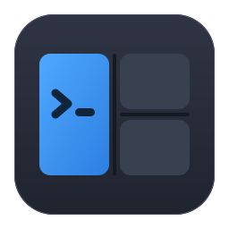

<p align="center"></p>

<h1 align="center">WinMux</h1>

<p align="center">
  <b>tmux, outside the terminal.</b><br>
  Split one window into panes and tabs, put a shell, a file browser or any ordinary Windows<br>
  application in each, and get the whole arrangement back on the next start.
</p>

<p align="center">
  <a href="https://winmux.renner.dev"><b>winmux.renner.dev</b></a> ·
  <a href="https://github.com/rennerdo30/winmux/releases/latest">Download</a> ·
  <a href="https://winmux.renner.dev/docs/">Documentation</a> ·
  <a href="https://winmux.renner.dev/docs/architecture/">Architecture decisions</a> ·
  <a href="https://github.com/rennerdo30/winmux/issues">Issues</a> ·
  <a href="LICENSE">MIT license</a>
</p>

## Why WinMux

Windows has four half-solutions and no whole one:

| Kind of tool | Examples | Panes | Process per pane | Non-terminal apps | Layout comes back |
|---|---|---|---|---|---|
| Terminal multiplexers | Windows Terminal, WezTerm, Zellij, Tabby | yes | yes | **no**, terminals only | partly |
| Tiling window managers | GlazeWM, komorebi, FancyWM | the whole desktop | yes | as loose desktop windows | weak |
| Window tabbers | Groupy, TidyTabs, WindowTabs | tabs only | yes | **yes** | no |
| Layout restorers | PowerToys Workspaces | no | yes | yes | **yes** |

WinMux is the intersection: real window embedding, tmux's split tree, ConPTY shells and
continuous persistence, in one host window with one keymap.

## What it does

| | |
|---|---|
| **A pane is a process** | Panes are hosted, not emulated. Terminals run on ConPTY; every application pane gets its own `WinMux.PaneHost` process, so a frozen app freezes its own pane and WinMux keeps drawing, taking keys and can still detach it. |
| **The layout is a tree** | Splits in columns and rows, resizable, and tab groups that nest anywhere with their strip on any edge. Every layout operation is a key, a toolbar button, a palette entry and a `wmux` command, all four calling the same named action. |
| **Sessions restore intent** | The tree, the tabs and each pane's program, arguments and working directory are saved continuously to a readable TOML file and rebuilt on the next start. Process state (scrollback, running jobs) is not restored, and WinMux says so. |
| **Four kinds of pane** | **Terminal** (cmd, PowerShell, pwsh, WSL, ssh), **file browser** (local, shares, SFTP and FTP, drag and drop between panes), **application** (embedded or attached) and **empty** (make it first, fill it later). Kinds are providers behind one public contract; a fifth can be loaded from a folder. |
| **Profiles** | A named thing you can put in a pane, created from the Start Menu's installed-app list rather than by typing paths. Open windows can be adopted into a pane. |
| **Looks like Windows 11** | Mica, your accent colour, light and dark, the toolbar in the title bar and real snap layouts. |
| **Updates itself, carefully** | Help → About checks GitHub and refuses any download whose SHA-256 does not match the published `checksums.txt`. No account, no telemetry; one setting turns the check off. |

## How it works

```
                        WinMux.exe  (Avalonia shell: layout tree, chrome, keymap, persistence)
                   ┌─────────────┼───────────────────────────┐
                   ▼             ▼                           ▼
        ConPTY + VT engine   file browser (in-process)   WinMux.PaneHost.exe, one per app pane
           cmd / pwsh / wsl     local · share · SFTP        owns a top-level host window and
                                                            embeds or attaches the app's window
                         │
                         ▼
       %APPDATA%\WinMux\session.toml   saved on a debounce after every change and every cd
```

- **The shell never makes a window call against a foreign window.** Measured in spike 3: an app
  that stops pumping messages blocked a shell holding its window for the full 6 s; with a separate
  pane host the shell stayed responsive ([ADR 0001](docs/adr/0001-out-of-process-pane-hosts.md)).
  Input queues are never attached across processes either: taking focus went from 201 ms to
  4,386 ms when they were ([ADR 0017](docs/adr/0017-input-queue-attachment.md)).
- **Working directories come from three layers**, best answer wins: the shell reporting it
  (OSC 9;9 / OSC 7, with shipped profile snippets), the process's own working directory, then the
  launch folder. Together they recovered 34 of 40 measured scenarios
  ([ADR 0004](docs/adr/0004-cwd-capture.md)).
- **`WinMux.Core` is platform-free** and `WinMux.Shell` declares no P/Invoke; both are enforced
  by tests ([ADR 0013](docs/adr/0013-phase-5-platform-layer.md)).

## Can it really host any Windows app?

No, not literally. Two strategies are implemented:

- **Embed** reparents the app's window into the pane: it moves, clips and resizes with the layout.
- **Attach** leaves the window top-level and keeps it lined up with the pane, the way a tiling
  window manager does. Less seamless, far more compatible.

`strategy = 'auto'` consults the shipped, user-editable `foreign-app-quirks.json`; unknown apps use
an explicitly unverified embed default. If embedding is refused, PaneHost keeps the same window
alive, explains why and attaches it instead. `Ctrl+Shift+P`, then `A`, switches the focused pane
live and remembers the choice.

| Application | Result in the measurements |
|---|---|
| Ordinary Win32 and Chromium-based apps | Embed, restored byte-exactly on detach |
| Store / packaged apps | Attach; Windows refuses embedding |
| Elevated apps | Refused and explained; WinMux is never elevated as a workaround |
| Monitors at different scales | Mixed-mode DPI hosting is enabled; physical verification is still outstanding |

When WinMux closes it detaches every foreign window. On the next start it reattaches one only
when the saved window handle, process ID and process start time still match; otherwise the pane
waits for an explicit **Launch new**, so a surviving app is never silently duplicated.
**Reattach surviving applications** in Settings turns automatic reattachment off. Details:
[ADR 0011](docs/adr/0011-phase-3-foreign-app-runtime.md).

## Get started

Download the newest release from the [releases page](https://github.com/rennerdo30/winmux/releases/latest):

- **`WinMux-<version>-win-x64-setup.exe`** installs for your account only, into
  `%LOCALAPPDATA%\Programs\WinMux`, with no administrator rights.
- **`WinMux-<version>-win-x64.zip`** is the same program; unzip it anywhere you can write to (not
  under Program Files, because WinMux updates its own files).

Requirements: Windows 10 1809+ or 11, x64, and the
[.NET 10 Desktop Runtime](https://dotnet.microsoft.com/download/dotnet/10.0) (setup checks for it).
Builds are not code-signed yet, so SmartScreen warns on first start; check downloads against
`checksums.txt`. Uninstalling keeps your sessions and settings in `%APPDATA%\WinMux`.

Then read [Getting started](https://winmux.renner.dev/docs/getting-started/) and
[Keyboard](https://winmux.renner.dev/docs/keyboard/).

### Keys

Every layout operation is a toolbar button, so nothing has to be memorised. The default keymap is
tmux-style behind `Ctrl+Shift+P`, which leaves `Ctrl+B` to terminal programs:

| Prefix, then | | Prefix, then | |
|---|---|---|---|
| `%` / `"` | split right / down | arrows, `Shift+arrows` | move focus, resize |
| `c` | new tab | `v` | tab group with tabs down the side |
| `n` / `p` | next / previous tab | `,` | rename pane |
| `e` | empty pane | `o` | adopt an open window |
| `x` | close | `w` | save |
| `A` | toggle embed / attach | `:` | command palette |
| `1`–`4` | cmd, Windows PowerShell, PowerShell 7, WSL | `i` | set up cwd reporting |

Press the prefix twice to pass it through. `--no-prefix` or `--keymap path.json` replaces the map.
In terminals `Ctrl+C` always interrupts and `Ctrl+V` reaches the application; copy with
`Ctrl+Shift+C` or `Ctrl+Insert`, paste with `Ctrl+Shift+V` or `Shift+Insert`. The mouse wheel goes
to applications that request mouse reporting and scrolls history otherwise; `Shift+wheel` always
scrolls history. `Alt+V` stays application input for image paste; `Escape` clears a selection and
still reaches the application. With close confirmation on (the default), terminals running child
programs ask before closing. Saved connections has a search box (also `Ctrl+F`) over names, folders,
hosts, users, domains and protocols.

The same actions from a script: `wmux split -h`, `wmux focus left`, `wmux new-tab`,
`wmux validate session.toml`. `wmux help` lists them all.

### From Explorer and the command line

Starting `WinMux.exe` once registers it in your per-user **App Paths**, so `winmux` works in
Explorer's address bar and the Run dialog without a PATH change (launch it again after moving the
folder). WinMux runs one process per Windows user: a bare `winmux` while it is running adds one CMD
tab at the caller's folder; an ordinary start restores the saved session without adding panes.

`WinMux.exe --open-directory "C:\path to\folder"` opens a folder explicitly, running or not. A
restored session gains exactly one CMD tab once its panes are ready; without a saved session the
default CMD and file browser both start there. The folder must exist; CMD cannot start in a UNC
path, so use a mapped drive. It cannot be combined with a session file. `--keymap` and
`--no-prefix` apply only on a cold start, and a forwarding timeout reports an error rather than
starting a duplicate.

### Rendering

Settings → Appearance → Rendering offers **Automatic** (Avalonia's ANGLE GPU backend with software
fallback, the default) and **Software** (CPU only, for VMs, remote desktops or driver problems).
Restart after changing it. It is stored as `rendering = 'automatic'` or `'software'` in
`%APPDATA%\WinMux\settings.toml`, which you can edit with WinMux closed if graphics problems stop
it from opening. It applies to WinMux's own interface and terminals, not to embedded applications,
and it is not a performance claim ([ADR 0026](docs/adr/0026-optional-gpu-rendering.md)).

## Build from source

Requirements: the .NET 10 SDK. For the installer, Inno Setup 7.

```powershell
git clone https://github.com/rennerdo30/winmux
cd winmux
.\run.cmd                                                   # build and launch
.\scripts\run.ps1 -Session .\examples\tabs-and-splits.toml  # nested tab groups
.\publish.cmd                                               # dist\WinMux-<version>-win-x64\ and a .zip
.\publish.cmd -SelfContained                                # also carries the .NET runtime
.\scripts\build-installer.ps1                               # dist\WinMux-<version>-win-x64-setup.exe
```

`run.cmd` and `scripts/run.ps1` use an isolated profile in this checkout's ignored
`artifacts/dev-data`, so development runs never touch the installed copy's settings, session,
crash log, launch endpoint or Explorer registration. To run `WinMux.exe` or `wmux.exe` directly
against a separate profile, set `WINMUX_DATA_DIR` to an absolute folder, with the same value for
both so CLI actions reach the right instance.

`.\scripts\phase2-demo.ps1` and `.\scripts\phase3-demo.ps1` (with `-Configuration Release`) walk
through persistence and foreign-app hosting visibly.

| Path | |
|---|---|
| `WinMux.Core` | Layout tree, session model, TOML, settings, keymap. No platform APIs. |
| `WinMux.Panes` | The public `IPaneProvider` / `IPaneRuntime` contract |
| `WinMux.Pty`, `WinMux.Terminal` | ConPTY and the VT-engine adapter |
| `WinMux.Platform`, `WinMux.Platform.Win32` | What an OS must provide, and the Windows implementation with the quirks database |
| `WinMux.PaneHost` | The out-of-process host for application panes |
| `WinMux.Shell` | The Avalonia app: chrome, rendering, input, overlays |
| `WinMux.Cli` | `wmux`, the command line |
| `samples/` | A pane provider loaded from outside the app |
| `docs/`, `website/` | Documentation (Starlight) and the homepage, published together |

## Status

Before 1.0. Phases 0 to 5 are complete: the spikes, the terminal multiplexer, persistence,
foreign apps, the file browser and the platform layer. Phase 6, the interface, is in progress;
tab and pane reordering, dragging a window into a pane, and scrollback search are still missing.
See [`HANDOFF.md`](HANDOFF.md) for where the work stands and [`CHANGELOG.md`](CHANGELOG.md) for
what shipped.

**Cross-platform** is a design discipline, not a promise. The layout engine, session format, PTY
contract and VT engine are platform-neutral, but only Windows is built and verified. Foreign-window
embedding has a hard boundary: possible on X11 (`XReparentWindow`, not written), impossible on
Wayland and macOS, where application panes would degrade to separate windows.

**Not goals:** reviving process state across restarts; replacing your desktop window manager; a
`tmux -d`-style detached daemon (possibly later, not v1); beating Windows Terminal at being Windows
Terminal.

## Prior art worth reading

- [Stardock Groupy](https://www.stardock.com/products/groupy/): proof that arbitrary-app embedding ships.
- [PowerToys Workspaces](https://microsoft.github.io/PowerToys/modules/workspaces/): the persistence bar to clear.
- [Windows Terminal panes](https://learn.microsoft.com/en-us/windows/terminal/panes) and
  [startup settings](https://learn.microsoft.com/en-us/windows/terminal/customize-settings/startup).
- [komorebi](https://github.com/lgug2z/komorebi), [GlazeWM](https://glazewm.com/),
  [FancyWM](https://github.com/FancyWM/fancywm): Windows window-manipulation techniques.
- [Raymond Chen on cross-process parent/child windows](https://devblogs.microsoft.com/oldnewthing/20130412-00/?p=4683):
  read this before writing any embedding code.

## License

WinMux is released under the [MIT license](LICENSE). A project by
[rennerdo30](https://github.com/rennerdo30).
